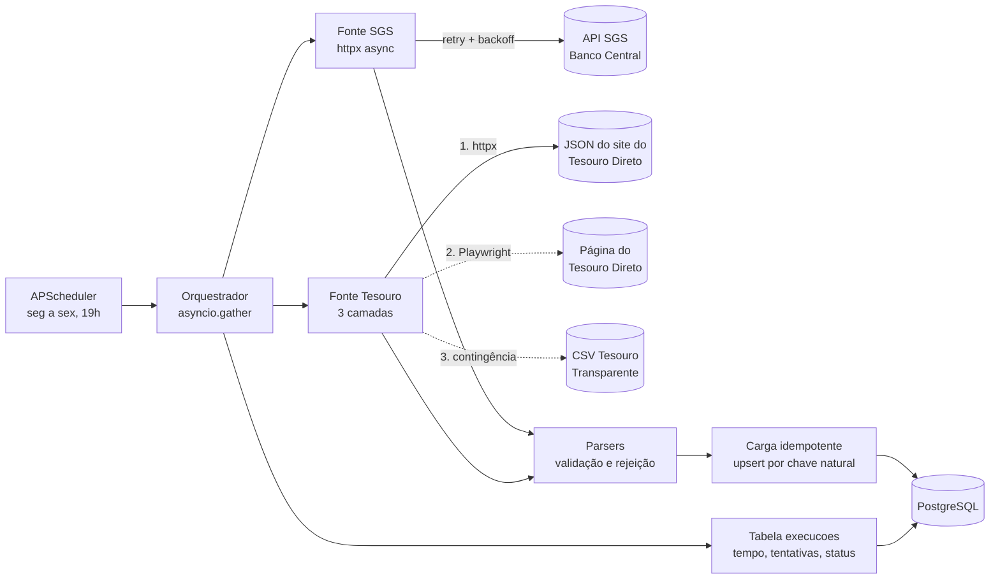

# Coletor de Taxas e Indicadores


Crawler assíncrono que coleta, todo dia útil, as taxas e preços dos títulos do
**Tesouro Direto** e as séries de **CDI, Selic e IPCA** do Banco Central (API SGS),
valida os dados e grava no PostgreSQL sem duplicar nada.

Ele resolve um problema concreto do portfólio: a
[API de carteira de renda fixa](https://github.com/viniciustakeuchi/api-carteira-renda-fixa)
projeta rendimentos com premissas de CDI, Selic e IPCA. Este coletor mantém essas premissas
atualizadas com dados oficiais (`coletor premissas`).

## Arquitetura



| Fonte | Como coleta | Dado |
| --- | --- | --- |
| `cdi` | API SGS, série 12 | CDI diário (% ao dia) |
| `selic` | API SGS, série 11 | Selic diária (% ao dia) |
| `selic_meta` | API SGS, série 432 | Meta Selic do Copom (% ao ano) |
| `ipca` | API SGS, série 433 | IPCA mensal (% ao mês) |
| `tesouro` | JSON do site; Playwright na página e CSV de dados abertos como contingência | Taxa e PU de compra e venda de cada título |

Cada fonte roda isolada e em paralelo: se o site do Tesouro cair, as séries do Banco Central
continuam sendo gravadas, e a falha fica registrada com o erro.

## Stack

Python 3.12 · asyncio · Playwright · httpx · Pydantic 2 · SQLAlchemy 2 (async) · Alembic ·
PostgreSQL · APScheduler · Typer · Pytest · Ruff · mypy (strict) · Docker · GitHub Actions

## Como rodar

Com Docker (sobe o banco, aplica as migrações, faz a primeira coleta e fica agendado):

```bash
docker compose up --build
```

Sem Docker, com um PostgreSQL local:

```bash
python -m venv .venv && source .venv/bin/activate
pip install -e ".[dev]"
python -m playwright install --with-deps chromium
cp .env.example .env          # ajuste DATABASE_URL
alembic upgrade head
coletor coletar               # todas as fontes, janela padrão
```

### Comandos

```bash
coletor coletar                          # todas as fontes
coletor coletar cdi ipca --desde 2020-01-01
coletor historico-tesouro --desde 2015-01-01   # carga histórica pelo CSV
coletor agendar --agora                  # processo contínuo com APScheduler
coletor relatorio --dias 30              # taxa de sucesso e tempo por fonte
coletor premissas                        # CDI, Selic e IPCA 12m em % a.a.
```

Saída de uma coleta real (GitHub Actions, 13/10/2026):

```text
cdi          sucesso     814 ms  5 gravados de 5 lidos, 0 rejeitados, 1 tentativa(s), via api
selic        sucesso    1078 ms  5 gravados de 5 lidos, 0 rejeitados, 1 tentativa(s), via api
selic_meta   sucesso     855 ms  11 gravados de 11 lidos, 0 rejeitados, 1 tentativa(s), via api
ipca         sucesso     917 ms  13 gravados de 13 lidos, 0 rejeitados, 1 tentativa(s), via api
tesouro      sucesso     434 ms  58 gravados de 58 lidos, 0 rejeitados, 1 tentativa(s), via api
```

Rodando de novo sobre o mesmo banco, todas as fontes mostram `0 gravados`: nada mudou, nada
foi reescrito.

`coletor premissas` devolve as taxas no formato que a API de renda fixa aceita na query
string. Valores reais da mesma data:

```json
{
  "cdi": {"valor": "13.65", "data_referencia": "2026-10-09"},
  "selic": {"valor": "13.75", "data_referencia": "2026-10-13"},
  "ipca": {"valor": "4.58", "data_referencia": "2026-09-01"}
}
```

O CDI de referência é o de 09/10 porque 12/10 foi feriado e o Banco Central publica o dia
corrente só à noite.

## Métricas

Toda execução grava uma linha em `execucoes` com duração, tentativas, camada usada,
registros lidos, rejeitados e gravados. `coletor relatorio` agrega por fonte (taxa de
sucesso, tempo médio, p95 e volume).

Primeiras execuções reais, no workflow [Coleta diária](.github/workflows/coleta.yml):

| Execução | cdi | selic | selic_meta | ipca | tesouro |
| --- | --- | --- | --- | --- | --- |
| 1ª, código original | 1,0 s | 0,2 s | 0,7 s | 0,7 s | 151 s, via CSV (API antiga respondeu 410) |
| 3ª, API nova | 0,8 s | 1,1 s | 0,9 s | 0,9 s | 0,4 s, via API, 58 títulos |
| 4ª, API nova | 2,6 s | 0,6 s | 2,6 s | 2,6 s | 0,4 s, via API, 58 títulos |
| 5ª, contingência forçada | 1,0 s | 31,9 s, timeout na 1ª tentativa e sucesso na 2ª | 1,0 s | 0,5 s | 2,8 s, via navegador, 37 títulos |

A 2ª execução, ainda com o código original, repetiu o resultado da 1ª e mostrou nos logs
estruturados que o endpoint antigo do Tesouro tinha sido desativado. Nas cinco execuções
foram 25 coletas de fonte e 25 sucessos. Na 5ª, a URL da API foi trocada de propósito
pela antiga, para provar a camada do Playwright contra o site real; no mesmo dia, um
timeout real do Banco Central foi absorvido pelo retry.

O workflow roda de segunda a sexta às 19h30, publica o relatório no resumo da execução e
guarda os dados coletados em CSV como artefato. Ele aceita uma URL alternativa da API do
Tesouro para repetir o teste de contingência.

## Testes e qualidade

```bash
pytest --cov=coletor     # 96 testes, cobertura de 99%, nenhum acessa a internet
ruff check . && ruff format --check .
mypy coletor tests
```

- **Parsers** são testados com respostas no formato de cada fonte, salvas em `tests/fixtures`
  (JSON do SGS, JSON do site do Tesouro e CSV do Tesouro Transparente), incluindo itens
  malformados. O JSON do Tesouro é um trecho real da API, com títulos fora de venda,
  Renda+, Educa+ e Tesouro Reserva.
- **Playwright** roda de verdade: um servidor HTTP local imita a página do Tesouro, que
  carrega os dados por `fetch`, e o teste confirma que o navegador captura o JSON, bloqueia
  imagens e CSS e estoura o timeout quando o JSON não chega.
- **Camadas do Tesouro** são testadas uma a uma: API no ar, API desativada (HTTP 410),
  formato novo na API, navegador fora do ar e queda completa até o CSV.
- **Retry** é testado com `httpx.MockTransport` simulando 503, 429, timeouts e HTML de
  manutenção no lugar de JSON.
- **Carga** roda em SQLite nos testes rápidos e no PostgreSQL no CI, que também aplica,
  desfaz e confere as migrações com `alembic check`.

## Decisões técnicas

- **Três camadas para o Tesouro, porque o site muda.** Durante o desenvolvimento, o site do
  Tesouro Direto trocou de plataforma: o endpoint JSON antigo passou a responder
  `410 Gone`. A primeira coleta real só não falhou porque caiu no CSV de contingência, e os
  logs estruturados mostraram onde estava o problema. Hoje a fonte tenta, nesta ordem:
  1. **API**: o JSON público que a página de rentabilidade usa, lido com httpx (rápido).
  2. **Navegador**: se a API mudar de endereço ou passar a recusar clientes HTTP, o
     Playwright abre a página e intercepta (`page.expect_response`) qualquer resposta de
     rentabilidade que ela carregue. Não depende de seletores CSS, e imagens, fontes e CSS
     são bloqueados para a página carregar mais rápido.
  3. **CSV** do Tesouro Transparente, com um dia de atraso, mas que mantém a série sem
     buracos.

  Cada execução registra qual camada foi usada, então uma degradação aparece no
  `coletor relatorio` antes de virar falha.
- **Backoff exponencial com jitter completo.** A espera é aleatória entre zero e
  `min(30s, 2s × 2^n)`. Só erros transitórios são repetidos (rede, 429 e 5xx); um 400 ou um
  formato inesperado falha na hora, porque repetir não resolve.
- **Upsert que só escreve quando o valor muda.** A chave natural (série + data, título +
  vencimento + data base) vira `ON CONFLICT DO UPDATE ... WHERE valor IS DISTINCT FROM`.
  Rodar duas vezes não duplica nada, uma revisão de dado do Banco Central é corrigida, e o
  número de linhas gravadas mede exatamente o que mudou.
- **Rejeitar o item, não a coleta.** Um ponto malformado é contado, logado e descartado; uma
  resposta inteira em formato desconhecido interrompe a fonte com `FormatoInesperado`.
- **`Decimal` do parser ao banco.** Taxas e preços nunca passam por `float`.
- **Logs em JSON, uma linha por evento**, prontos para CloudWatch ou Loki
  (`LOG_FORMATO=texto` no desenvolvimento).
- **Uma armadilha do APScheduler 3:** em `CronTrigger.from_crontab`, `1-5` no dia da semana
  significa terça a sábado, porque a contagem começa em segunda = 0. O padrão usa
  `mon-fri`, e um teste confere os próximos disparos de verdade.

### Limitações conhecidas

- O JSON do site do Tesouro não é uma API documentada e pode mudar sem aviso, como já
  mudou; por isso existem as camadas de contingência e o parser falha alto em vez de gravar
  lixo.
- O nome do título vem sem o ano do vencimento (`Tesouro IPCA+`), que fica em coluna própria.
  Títulos novos podem ter nomes diferentes entre o site e o CSV.
- O CSV histórico traz todos os títulos desde o início da série e é baixado inteiro a cada
  uso.
- Pela camada do navegador, a página carrega só os títulos abertos para compra (37 de 58);
  os que estão só para resgate voltam na coleta seguinte pela API ou pelo CSV.

### Próximos passos

- Levar a coleta para a AWS com Lambda, S3 e EventBridge (projeto 3 do portfólio).
- Endpoint na API de renda fixa lendo as premissas direto deste banco.
- Alertas quando a taxa de sucesso de uma fonte cair abaixo de um limite.

## Licença

MIT
